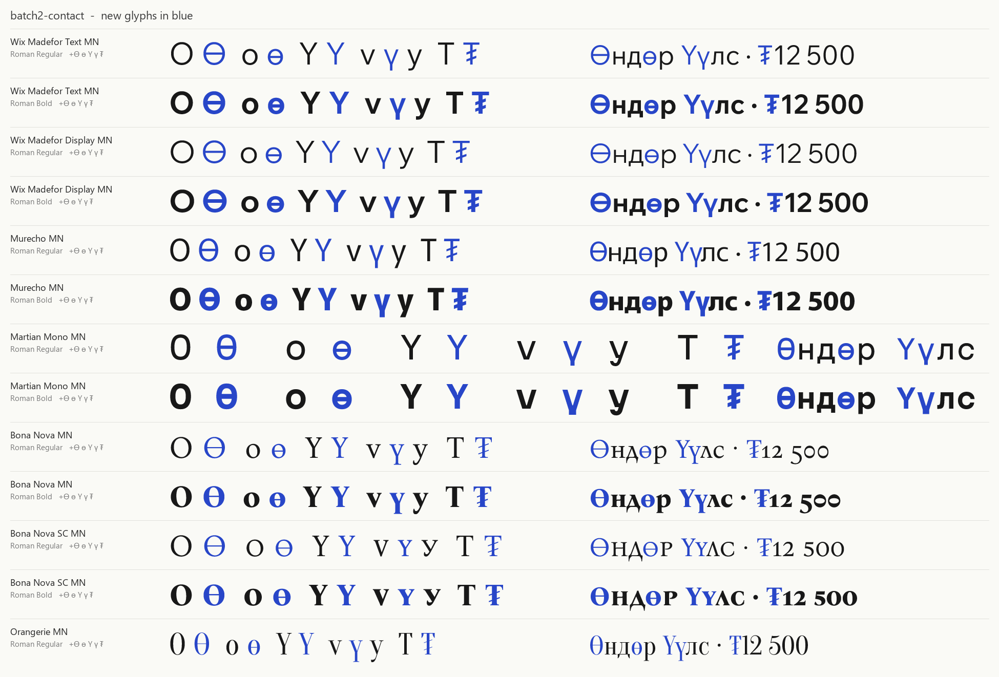
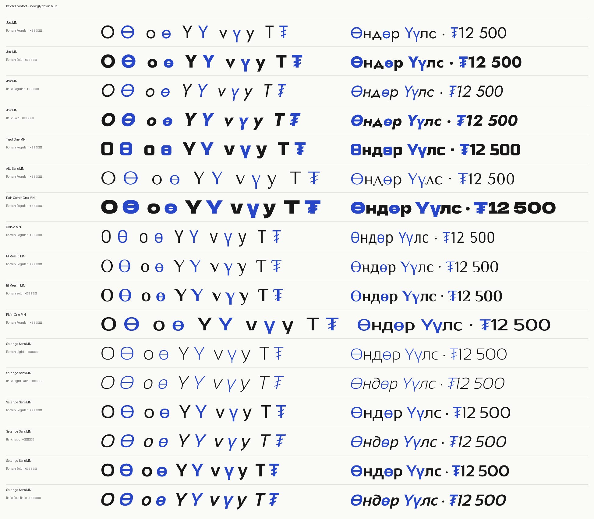

# Монгол хувилбар фонтууд · Mongolian font editions

Нээлттэй лицензтэй (SIL OFL) 25 фонтод дутуу байсан Монгол үсгүүд **Ө ө Ү ү** болон **₮** тэмдгийг фонт бүрийн өөрийн хэв маягаар нэмсэн хувилбарууд. Бүгд арилжааны хэрэглээнд үнэгүй: зар, лого, хэвлэл, вэб, апп.

Twenty-five open-licensed (SIL OFL) fonts that had full Cyrillic but lacked the Mongolian letters **Ө ө Ү ү** and the tögrög sign **₮**, with those characters added in each font's own style. All are free for commercial use.

Part of [Фонт Шүүгч · Mongolian Font Finder](https://kizaialt.github.io/mn-font-finder/), where you can preview every edition.





## Download · Татах

Each family is a zip on the [Releases page](https://github.com/Kizaialt/mn-font-editions/releases/latest), with its fonts, `OFL.txt` and `FONTLOG.md`. On Windows, right-click the font files and choose **Install for all users**.

| Edition | Based on | Files | Styles |
|---|---|---|---|
| **Alto Sans MN** | [Tenor Sans](https://github.com/googlefonts/googlefontdirectory-hg) by Denis Masharov | 1 static | roman |
| **Alumni Sans MN** | [Alumni Sans](https://github.com/googlefonts/alumni) by Robert Leuschke | variable + 18 static | roman + italic |
| **Alumni Sans Pinstripe MN** | [Alumni Sans Pinstripe](https://github.com/googlefonts/alumni-sans-pinstripe) by Robert Leuschke | 2 static | roman + italic |
| **Alumni Sans SC MN** | [Alumni Sans SC](https://github.com/googlefonts/alumni) by Robert Leuschke | variable + 18 static | roman + italic |
| **Bona Nova MN** | [Bona Nova](https://github.com/kosmynkab/Bona-Nova) by Capitalics, Mateusz Machalski, Andrzej Heidrich | 2 static | roman |
| **Bona Nova SC MN** | [Bona Nova SC](https://github.com/kosmynkab/Bona-Nova) by Capitalics, Mateusz Machalski, Andrzej Heidrich | 2 static | roman |
| **Dela Gothic One MN** | [Dela Gothic One](https://github.com/syakuzen/DelaGothic) by artakana | 1 static | roman |
| **El Messiri MN** | [El Messiri](https://github.com/Gue3bara/El-Messiri) by Mohamed Gaber, Jovanny Lemonad | variable + 4 static | roman |
| **Gidole MN** | [Gidole](https://github.com/googlefonts/gidole) by Andreas Larsen | 1 static | roman |
| **Jost MN** | [Jost](https://github.com/indestructible-type/Jost) by Owen Earl | variable + 18 static | roman + italic |
| **Jura MN** | [Jura](https://github.com/ossobuffo/jura) by Daniel Johnson, Cyreal | variable + 5 static | roman |
| **Martian Mono MN** | [Martian Mono](https://github.com/evilmartians/mono) by Roman Shamin, Evil Martians | variable + 8 static | roman |
| **Murecho MN** | [Murecho](https://github.com/positype/Murecho-Project) by Neil Summerour | variable + 9 static | roman |
| **Orangerie MN** | [Oranienbaum](https://github.com/googlefonts/googlefontdirectory-hg) by Oleg Pospelov, Jovanny Lemonad | 1 static | roman |
| **Plain One MN** | [Prosto One](https://github.com/googlefonts/googlefontdirectory-hg) by Jovanny Lemonad, Pavel Emelyanov | 1 static | roman |
| **Selenge Sans MN** | [Sansation](https://github.com/googlefonts/googlefontdirectory-hg) by Bernd Montag | 6 static | roman + italic |
| **Sofia Sans MN** | [Sofia Sans](https://github.com/lettersoup/Sofia-Sans) by Lettersoup, Botio Nikoltchev, Ani Petrova | variable + 18 static | roman + italic |
| **Sofia Sans Condensed MN** | [Sofia Sans Condensed](https://github.com/lettersoup/Sofia-Sans) by Lettersoup, Botio Nikoltchev, Ani Petrova | variable + 18 static | roman + italic |
| **Sofia Sans Extra Condensed MN** | [Sofia Sans Extra Condensed](https://github.com/lettersoup/Sofia-Sans) by Lettersoup, Botio Nikoltchev, Ani Petrova | variable + 18 static | roman + italic |
| **Sofia Sans Semi Condensed MN** | [Sofia Sans Semi Condensed](https://github.com/lettersoup/Sofia-Sans) by Lettersoup, Botio Nikoltchev, Ani Petrova | variable + 18 static | roman + italic |
| **Tuul One MN** | [Russo One](https://github.com/googlefonts/russoone) by Jovanny Lemonad | 1 static | roman |
| **Unbounded MN** | [Unbounded](https://github.com/googlefonts/unbounded) by NaN | variable + 8 static | roman |
| **Wix Madefor Display MN** | [Wix Madefor Display](https://github.com/wix/wixmadefor) by Dalton Maag | variable + 5 static | roman |
| **Wix Madefor Text MN** | [Wix Madefor Text](https://github.com/wix-incubator/wixmadefor) by Dalton Maag | variable + 5 static | roman |
| **Yanone Kaffeesatz MN** | [Yanone Kaffeesatz](https://github.com/yanone/kaffeesatz) by Yanone, Cyreal | variable + 6 static | roman |

Italics are included where the original has Cyrillic italics that the method can extend. Wix Madefor Text's italic has no Cyrillic, and Bona Nova's italic uses a cursive v, so those are roman only. Yanone Kaffeesatz already had ₮, so it gains Ө ө Ү ү only. Jost and Sansation (Selenge Sans MN) include their italics.

## How the letters were made

Every new letter is built from the font's own shapes, never drawn in a different style:

- **Ө ө**: the font's own barred O (Ɵ ɵ) where it has one, otherwise its О о with a bar matching the font's crossbar weight.
- **Ү**: the font's Latin Y. Kerning comes from Y through look-alike Cyrillic pairs.
- **ү**: the font's v continued as a straight stem to the descender, using the font's own stem weight and descender depth.
- **₮**: the font's Т with two parallel strokes, angle and thickness solved per weight so heavy weights keep open gaps.

Where an original's outlines run in PostScript (counter-clockwise) order, the new glyphs are still built in TrueType order; where it kerns with an old-style `kern` table, the new letters are kerned there too. Variable fonts stay variable. Existing glyphs are byte-identical to the originals, and every build passes the OpenType Sanitizer. Each family's `FONTLOG.md` records the details.

## License

Each edition keeps the [SIL Open Font License 1.1](https://openfontlicense.org/) of its original; see `OFL.txt` in each folder. The original copyright notices are kept, and the Mongolian additions are credited to the Font Shuugch project. Some originals declare a Reserved Font Name that modified versions may not use, so their editions are renamed: **Orangerie MN** is Oranienbaum, **Tuul One MN** is Russo One (reserved: "Russo"), **Alto Sans MN** is Tenor Sans ("Tenor", "Tenor Sans"), **Plain One MN** is Prosto One ("Prosto", "Prosto One") and **Selenge Sans MN** is Sansation ("Sansation"). Each FONTLOG.md names the original.

These editions are not made or endorsed by the original designers. Mongolian support is offered back to each original project, so future official versions may include it.

## Rebuilding

The build tools are in `tools/` (Python 3.12, `pip install fonttools skia-pathops uharfbuzz opentype-sanitizer`). Download a family's original files from [google/fonts](https://github.com/google/fonts) into `sources/<slug>/`, then:

```
python -P tools/build_mn.py tools/families/<slug>.json
python -P tools/verify_mn.py tools/families/<slug>.json
python -P tools/proof_mn.py tools/families/<slug>.json --tag v1
```

Each family's settings are in `tools/families/<slug>.json`.
